<p align="center">
  
</p>

# KittyBoom - Bomberman 2D en Java

<p align="left">
  
  
  
  
  
  
</p>

Recreación para escritorio del clásico Bomberman desarrollada en Java con interfaz gráfica Swing/AWT. El objetivo principal de la práctica fue aplicar principios de diseño orientado a objetos, el patrón arquitectural Modelo-Vista-Controlador (MVC) y patrones de diseño clásicos (GoF) para evitar código monolítico y facilitar la extensión del juego.

---

## Índice
- [Descripción general](#descripción-general)
- [Arquitectura y Patrones de Diseño](#arquitectura-y-patrones-de-diseño)
- [Imágenes y Jugabilidad](#imágenes-y-jugabilidad)
- [Controles](#controles)
- [Estructura del proyecto](#estructura-del-proyecto)
- [Instrucciones de ejecución](#instrucciones-de-ejecución)
- [Equipo](#equipo)
- [Contexto académico](#contexto-académico)

---

## Descripción general

El proyecto implementa las mecánicas base de Bomberman (movimiento en cuadrícula, colocación de bombas con temporizador, destrucción de bloques blandos y detección de colisiones) junto con elementos adicionales como selección de personajes, diferentes tipos de tableros y una fase final contra un jefe.

Aspectos técnicos clave:
- Separación de responsabilidades: la lógica del juego reside en el modelo y no depende directamente de componentes visuales de Swing.
- Actualización reactiva mediante eventos: uso de observadores para redibujar únicamente las casillas que cambian de estado en vez de repintar todo el panel en cada ciclo.
- Gestión polimórfica de entidades: creación y comportamiento de bloques y bombas desacoplados mediante factorías y estrategias.
- Sin dependencias externas: compilado con la librería estándar de Java SE.

---

## Arquitectura y Patrones de Diseño

El código sigue una estructura MVC estricta:

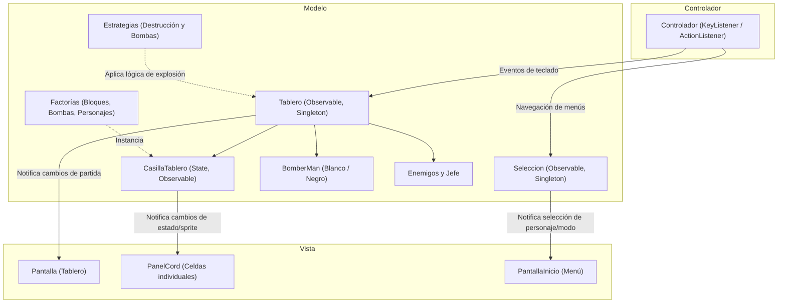

### Patrones de diseño implementados

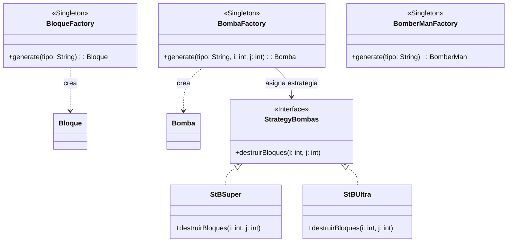

- **Factory Method:** Implementado en `BloqueFactory`, `BombaFactory` y `BomberManFactory` para centralizar la instanciación según el tipo necesario (`Blando`, `Duro`, `Barrera`, `BSuper`, `BUltra`, etc.) sin que el llamador conozca la clase concreta.
- **Strategy:** Empleado en `StrategyBombas` (`StBSuper`, `StBUltra`) y `StrategyBloques` para definir de forma intercambiable los radios de explosión y la densidad de bloques por mapa.
- **Observer:** `ObserverTableroPantalla` y las casillas observables comunican cambios a `PanelCord` y `Pantalla` únicamente cuando ocurre un evento relevante (movimiento, explosión, muerte), optimizando el renderizado de Swing.
- **State:** `StateCasilla` gestiona las transiciones internas de cada celda del tablero (vacía, con bomba activa, en explosión o con objeto).
- **Singleton:** Empleado en `Tablero`, `Seleccion` y en las factorías para asegurar un único punto de acceso global durante la partida.

---

## Imágenes y Jugabilidad

### Menú de inicio y selección de tablero
<p align="center">
  
  &nbsp;&nbsp;&nbsp;&nbsp;
  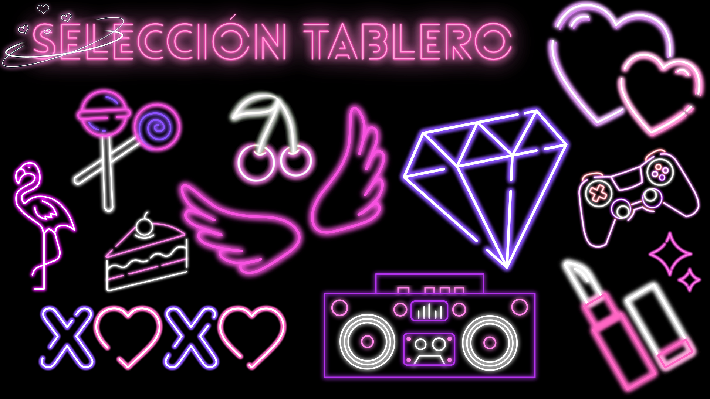
</p>

| Personaje Blanco (`BomberManBlanco`) | Personaje Negro (`BomberManNegro`) |
| :---: | :---: |
|  | 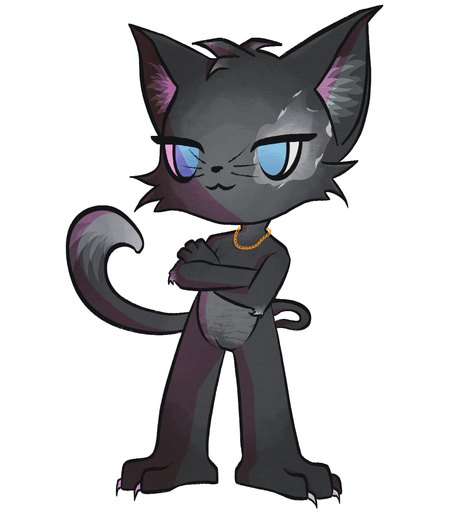 |

### Escenarios y combate contra el jefe final
<p align="center">
  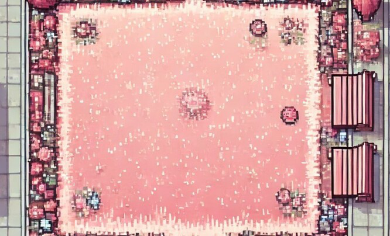
  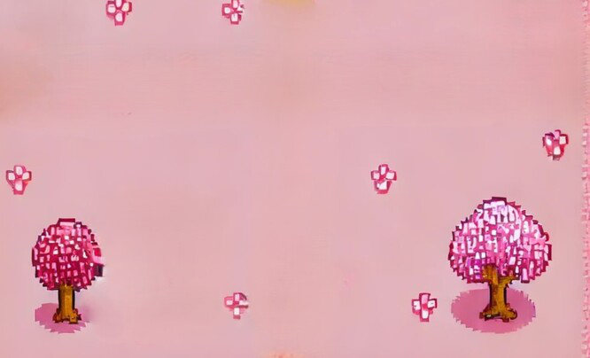
  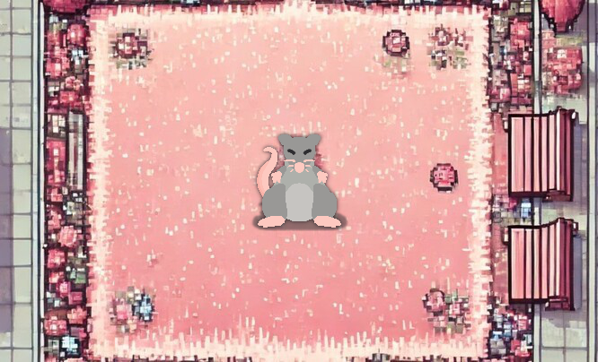
</p>

<p align="center">
  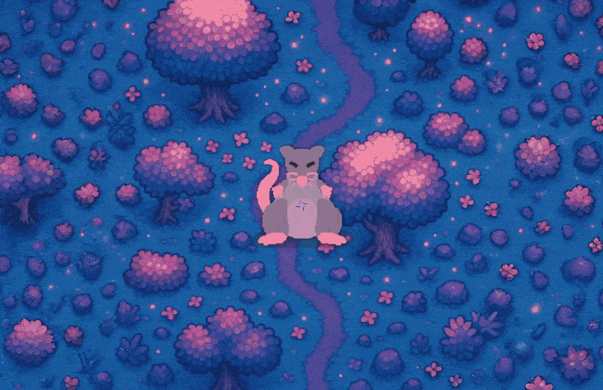
  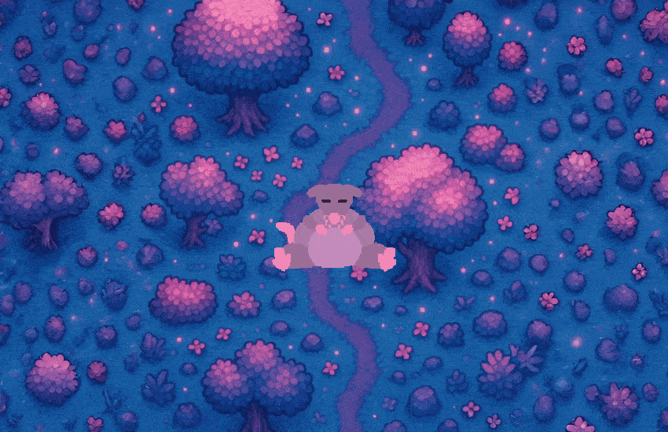
  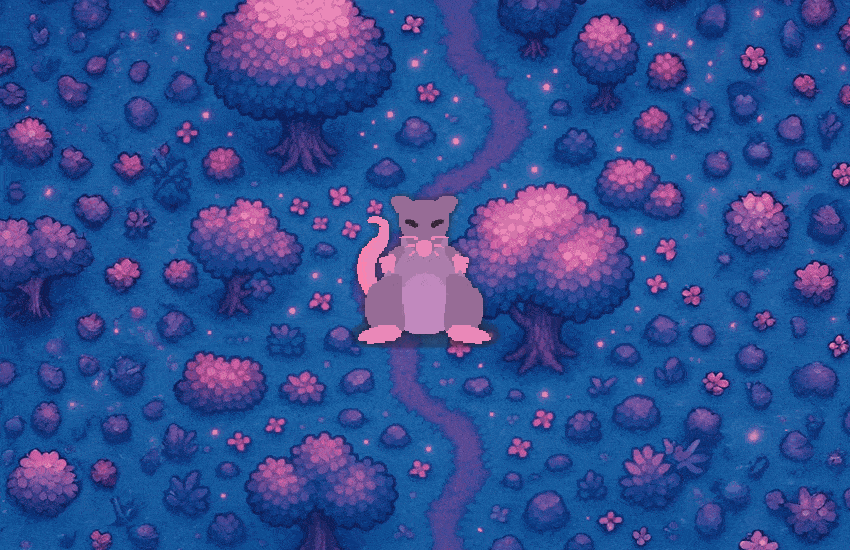
  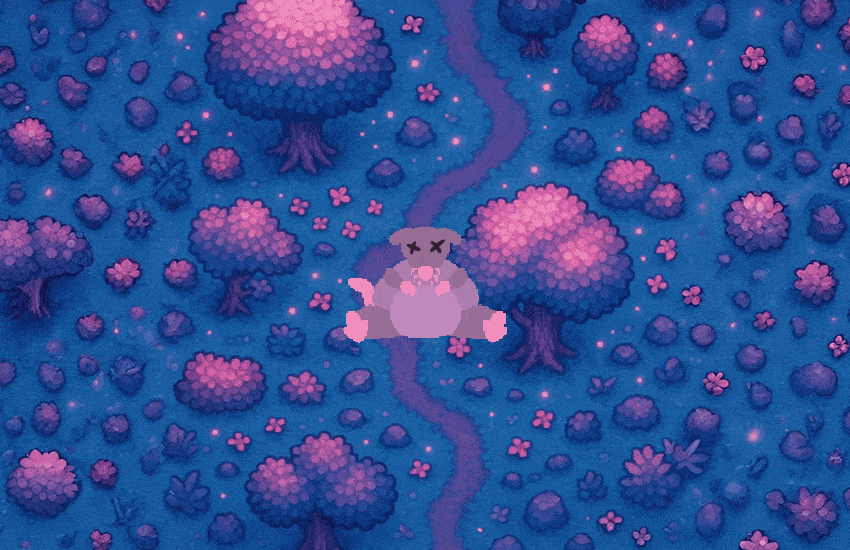
</p>

---

## Controles

| Menú principal | Acción | Tecla |
| :--- | :--- | :--- |
| Menú | Cambiar personaje seleccionado | Flechas izquierda / derecha |
| Menú | Configurar opciones de tablero | O |
| Menú | Iniciar partida | Intro o Espacio |

| En partida | Acción | Tecla |
| :--- | :--- | :--- |
| Partida | Mover arriba / abajo | W / S (o flechas arriba / abajo) |
| Partida | Mover izquierda / derecha | A / D (o flechas izquierda / derecha) |
| Partida | Colocar bomba | Espacio |

---

## Estructura del proyecto

```text
BombermanGE/
├── .github/workflows/
│   └── build.yml               # Pipeline de compilación automática en GitHub Actions
├── BombermanGE/
│   └── src/
│       ├── Diagramas/          # Diagramas de clases de apoyo (.cld)
│       ├── main/
│       │   └── main.java       # Clase principal y arranque del juego
│       ├── model/              # Lógica de dominio: entidades, factorías, estrategias y estados
│       └── viewController/     # Vistas Swing, controladores de eventos y recursos gráficos
├── Bomberman.jar               # Archivo JAR ejecutable compilado
├── Jugar.bat                   # Script de arranque rápido para Windows
└── README.md
```

---

## Instrucciones de ejecución

### Requisitos
- Java JRE o JDK 17 o superior instalado.

### Opción 1: Ejecución directa en Windows (recomendada)
Hacer doble clic en el archivo `Jugar.bat` o ejecutarlo desde la terminal:
```cmd
git clone https://github.com/28ivan/kittyboom-bomberman.git
cd kittyboom-bomberman
Jugar.bat
```

### Opción 2: Ejecutar el archivo JAR
```bash
java -jar Bomberman.jar
```

### Opción 3: Abrir desde un IDE (Eclipse o IntelliJ)
1. Importar el proyecto abriendo la carpeta `BombermanGE`.
2. Verificar que `BombermanGE/src` esté configurada como carpeta de fuentes (*Source Folder*).
3. Ejecutar la clase `main.main.java`.

---

## Integración Continua (CI/CD)

El repositorio incluye un flujo de trabajo de GitHub Actions (`.github/workflows/build.yml`) que en cada `push` compila el código con OpenJDK 17 y genera el archivo `Bomberman.jar` como artefacto descargable.

---

## Equipo

Proyecto desarrollado de forma colaborativa por:
- **[Iván Herrera](https://github.com/28ivan)**
- Aimar Larriba
- Lou Gómez
- Daniel Talmaci
- David Miguez

---

## Contexto académico

Proyecto desarrollado para la asignatura de **Ingeniería del Software** dentro del **Grado en Ingeniería Informática de Gestión y Sistemas de Información** en la **Universidad del País Vasco (UPV/EHU)**.

Distribuido bajo licencia MIT.
